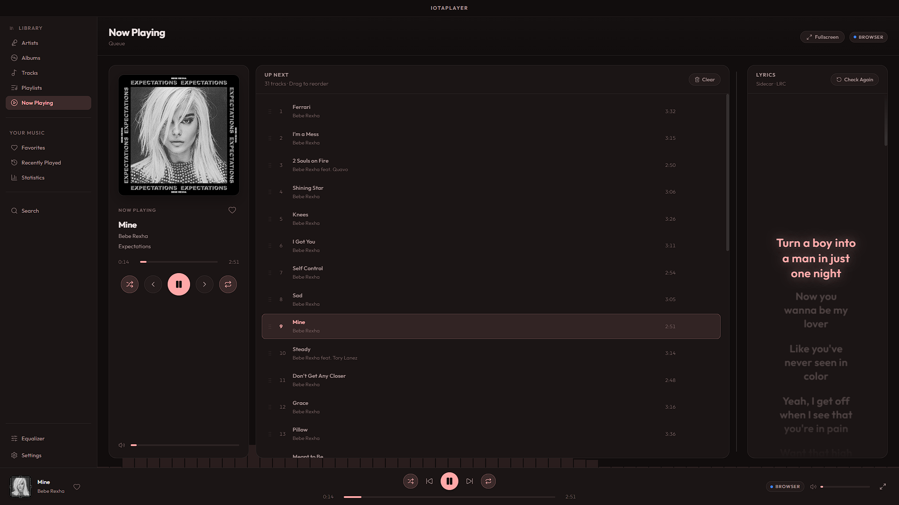
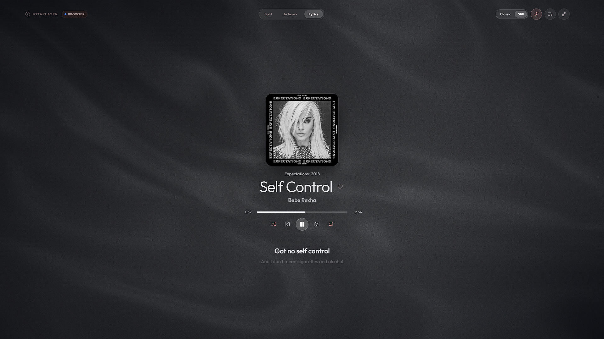

# IotaPlayer

A local-first desktop music player built with **Electron**, **React 19**, **TypeScript**, **SQLite**, and **MPV**.

IotaPlayer indexes your local audio library into a fast SQLite database and pairs high-compatibility native playback (via MPV with an automatic Web Audio fallback) with an intentional, cohesive desktop interface—complete with word- and line-synchronized lyrics, a 10-band parametric equalizer, playback speed & pitch presets, smart playlists, library statistics, localization, and Discord Rich Presence.

---

## Table of Contents

- [Highlights](#highlights)
- [Screenshots](#screenshots)
- [Quick Start](#quick-start)
- [Feature Guide](#feature-guide)
  - [1. Playback, Speed & Audio Engine](#1-playback-speed--audio-engine)
  - [2. Lyrics System & Fullscreen Now Playing](#2-lyrics-system--fullscreen-now-playing)
  - [3. Library, Playlists, Smart Playlists & Statistics](#3-library-playlists-smart-playlists--statistics)
  - [4. Keyboard Shortcuts & OS Media Controls](#4-keyboard-shortcuts--os-media-controls)
- [Architecture & Project Structure](#architecture--project-structure)
- [Tech Stack](#tech-stack)
- [Performance & Hardware Notes](#performance--hardware-notes)
- [Roadmap](#roadmap)
- [Documentation](#documentation)
- [Credits & Third-Party Notices](#credits--third-party-notices)

---

## Highlights

- **Dual Playback Engine & Speed/Pitch Control** - Uses **MPV** over IPC as the primary high-format-compatibility backend, with a seamless **Browser / Web Audio** fallback supporting a live frequency spectrum visualizer, a 10-band parametric equalizer, and configurable playback speed & pitch presets (**Normal**, **Nightcore**, **Fast Nightcore**, **Daycore**, **Slowed**, **Custom**).
- **Race-Free Volume, Shuffle & Playback Persistence** - Restores persisted volume, repeat, shuffle, and per-track playback positions on launch, hydrating the active audio backend before playback becomes audible to prevent startup volume spikes, paired with history-preserving Fisher-Yates shuffle.
- **Word- & Line-Synchronized Lyrics Engine** - Supports **Lyricsfile 1.0** (`.lyricsfile.yaml` / `.lyricsfile.yml`), **Enhanced LRC** (`<mm:ss.xx>`), standard **LRC**, **embedded tags** (`SYLT`, `USLT`, Vorbis/FLAC `LYRICS`), and plain `.txt` sidecars with configurable source priority (including an **Ignore embedded lyrics** option in `Best synchronized` mode), word-by-word highlighting, click-to-word/line seeking, and animated instrumental break indicators.
- **Immersive Now Playing Experiences** - Switch between the 3-pane resizable **Now Playing** workspace and the **Fullscreen Now Playing** overlay with **Classic** (blurred album-art backdrop with `Split`, `Artwork`, and `Lyrics` modes) and **Still** (editorial dark-glass ambient mesh with subtle film grain) styles.
- **Fast SQLite Library, Smart Playlists & Insights** - Indexes tracks, albums, artists, and embedded artwork with `music-metadata` and `better-sqlite3`. Includes multi-field search, **Media Quality Badges** (`Hi-Res`, `Lossless`, lossy codecs) & **Track File Inspector**, **Smart Playlists** (`ALL` / `ANY` rule builder), **Library Format Statistics**, missing-file cleanup, favorites, playback history, and drag-and-drop playlists with custom cover art.
- **Internationalization & Desktop Integration** - Full **English** and **Polish** localization (with automatic system locale detection), hardware media key support via OS Media Session, frameless custom window chrome, and Discord Rich Presence with native `"Listening to"` activity status.

---

## Screenshots

| Now Playing | Fullscreen (Still Ambient) |
| :---: | :---: |
|  |  |

Browse all 14 screenshots (Library, Smart Playlists, Statistics, Equalizer & Speed, Settings, and more) in the **[Visual Gallery & Documentation](docs/README.md)**.

---

## Quick Start

### Prerequisites

- **Node.js** 22+ and **npm**
- **MPV** installed and available on your system `PATH` (optional but recommended for full codec support; IotaPlayer automatically falls back to the browser audio engine if MPV is unavailable)

### Installation & Development

```bash
# Install dependencies (also runs postinstall patch for discord-rpc listening activity support)
npm install

# Start Vite renderer + Electron in development mode
npm run dev
```

### Build, Lint & Test

```bash
# Compile Electron main/preload TypeScript and Vite renderer bundle
npm run build

# Run the Node unit test suite (lyrics, volume hydration, MPV IPC, settings, media controls)
node --test tests/*.test.mjs

# Run ESLint across renderer and Electron sources
npm run lint
```

### Packaging

```bash
# Package a distributable desktop build via Electron Forge
npm run package
```

---

## Feature Guide

### 1. Playback, Speed & Audio Engine
- **Backends**: Choose between **MPV** (primary native backend) and **Browser** (`HTMLAudioElement` + Web Audio API) in Settings, with a live backend badge in the player bar and Now Playing headers.
- **Startup Volume Synchronization**: Persists normalized volume (`0..1`) in user settings and coordinates startup hydration with both MPV IPC socket readiness and `HTMLAudioElement` creation so audio never spikes to 100% on cold launch.
- **Queue, Shuffle & Transport Controls**:
  - Play, pause, seek, volume, mute toggle, Fisher-Yates shuffle (with playback history navigation and cycle management), and repeat (`off`, `all`, `one`).
  - Smart previous-track behavior (restarts current track if playback is past 3 seconds; otherwise jumps to the previous track).
  - Resizable **Up Next** queue panel with drag-and-drop reordering, move up/down actions, per-track removal, queue clearing, and **Save Queue as Playlist**.
- **Playback Speed & Pitch Control**:
  - Built-in presets (**Normal**, **Nightcore**, **Fast Nightcore**, **Daycore**, **Slowed**, **Custom**) with fine-grained speed adjustment and a **Preserve Pitch** toggle across both MPV and Browser backends.
  - Speed-aware lyrics and word-level interpolation stay synchronized at any playback rate.
- **10-Band Parametric Equalizer & Visualizer**:
  - 10 frequency bands (`31 Hz` – `16 kHz`) with `−12 dB` to `+12 dB` gain range.
  - Built-in presets (`Flat`, `Warm`, `Bright`, `Bass`, `Vocal`, `Club`) plus custom curve persistence.
  - Real-time canvas spectrum visualizer in the bottom player bar (active on the Browser audio backend).

### 2. Lyrics System & Fullscreen Now Playing
- **Supported Formats & Sources**:
  - **Sidecar files** next to the audio file: `.lyricsfile.yaml` / `.lyricsfile.yml` ([Lyricsfile 1.0 Specification](https://github.com/tranxuanthang/lyricsfile/blob/main/SPECIFICATION.md)), `.lrc` (standard and Enhanced LRC), and `.txt`.
  - **Embedded metadata**: ID3v2 `SYLT` / `USLT` and Vorbis/FLAC `LYRICS` / `UNSYNCEDLYRICS` tags (automatically detecting embedded LRC or Lyricsfile YAML content).
- **Resolution Modes** (configurable in **Settings → Lyrics**):
  - `Embedded first` *(default)*: Embedded → `.lyricsfile.yaml` → `.lrc` → `.txt`
  - `Best synchronized`: Ranks candidates by actual parsed sync quality (`word` > `line` > `none`), breaking ties by `Lyricsfile` → `LRC` → `Embedded` → `Plain` (includes an **Ignore embedded lyrics** toggle to prefer downloaded sidecar files)
  - `Sidecar files first`: `.lyricsfile.yaml` → `.lrc` → `.txt` → Embedded
- **Playback Synchronization**:
  - **Word-level sync**: Highlights words as they are sung with sub-16ms `requestAnimationFrame` boundary detection and allows clicking any individual word to seek directly to its timestamp.
  - **Line-level sync**: Auto-scrolls the active lyric line into center view (pausing auto-scroll temporarily when the user scrolls manually) and seeks on line click.
  - **Instrumental gaps**: Renders an animated three-dot `LyricGapIndicator` for explicit empty timestamped lines, intro gaps (`≥ 6s`), and outro gaps (`≥ 8s`).
- **Fullscreen Styles**:
  - **Classic**: Dynamic blurred album-art backdrop with `Split`, `Artwork`, and `Lyrics` focus modes.
  - **Still**: Editorial dark-glass ambient mesh extracted from cover art with subtle film grain and GPU-composited transitions.

### 3. Library, Playlists, Smart Playlists & Statistics
- **Library Indexing**: Scans a configured root folder recursively, extracting track metadata, audio format details, durations, and album artwork into SQLite.
- **Media Quality Badges & File Inspector**: Displays `Hi-Res`, `Lossless`, and lossy codec badges (`AAC`, `MP3`, `Opus`, etc.) alongside a **Track File Inspector** for detailed codec, sample rate, bit depth, bitrate, channel, and file path info.
- **Smart Playlists**: Create dynamic playlists using configurable `ALL` / `ANY` rule groups across track fields (title, artist, album, genre, codec, play count, favorite status, duration, and more).
- **Library Statistics**: Dedicated **Statistics** view with SQL-aggregated totals, quality tier distribution, codecs, sample rates, and top genres.
- **Library Maintenance**: Includes a **Clean Up Missing Files** tool in Settings to prune moved or deleted files and orphaned album/artist records, plus classification of unsupported codecs vs missing files.
- **Views**:
  - **Tracks**, **Albums**, **Album Detail**, **Artists**, **Artist Detail**, **Search**, **Statistics**
  - **Playlists** & **Playlist Detail** (standard and smart playlists, custom cover image upload, drag-and-drop track reordering)
  - **Favorites** & **Recently Played** (with one-click history clearing)
  - **Now Playing**, **Fullscreen Now Playing**, **Equalizer**, and **Settings** (including **Language** and **Credits & Notices**)

### 4. Keyboard Shortcuts & OS Media Controls

#### In-App Shortcuts

| Shortcut | Action |
| :--- | :--- |
| `Space` | Play / Pause |
| `F` | Toggle Fullscreen Now Playing overlay |
| `Escape` | Exit Fullscreen Now Playing overlay |

> Shortcuts are automatically ignored when focus is inside an `<input>`, `<textarea>`, `<select>`, or `contenteditable` element.

#### System Media Keys (OS Media Session)

| Media Key | Action |
| :--- | :--- |
| `Play` / `Pause` / `Stop` | Resume or pause playback |
| `Previous Track` | Restart current track (if `> 3s` in) or go to previous track |
| `Next Track` | Skip to next track in queue |
| `Seek Backward` / `Forward` | Seek `±15s` (or OS-requested offset) |

---

## Architecture & Project Structure

```text
iotaplayer-rewrite/
├── electron/                  # Electron main process & preload bridge (TypeScript → dist-electron/)
│   ├── main.ts                # App lifecycle, BrowserWindow setup, protocol registration
│   ├── ipc.ts                 # IPC handlers (library queries, playback, settings, playlists)
│   ├── preload.ts             # Context-isolated window.library / window.player / window.settings APIs
│   ├── db.ts                  # SQLite schema, migrations, and query helpers (better-sqlite3)
│   ├── scanner.ts             # Recursive audio file discovery, metadata/artwork extraction
│   ├── mpv.ts                 # MPV child process & JSON IPC socket controller
│   ├── volume.ts              # Startup volume hydration & cross-backend volume state coordinator
│   ├── lyrics.ts              # Lyricsfile 1.0, Enhanced LRC, standard LRC, and embedded parser/resolver
│   ├── lyricsSync.ts          # Line- and word-level playback synchronization helpers
│   ├── mediaControls.ts       # OS media control snapshot normalization
│   ├── settings.ts            # JSON settings persistence in userData
│   └── discord.ts             # Discord Rich Presence client integration
├── src/                       # React 19 renderer application (Vite)
│   ├── audio/
│   │   └── browserPlayer.ts   # HTMLAudioElement fallback + Web Audio 10-band EQ & analyser
│   ├── components/            # Shared UI components (Sidebar, PlayerBar, FullscreenNowPlaying, etc.)
│   ├── hooks/                 # Data fetching, artwork cache, lyrics loading & 60fps word-sync hooks
│   ├── store/                 # Zustand stores for navigation, playback, queue, playlists, and EQ
│   ├── styles/                # Layered CSS architecture (tokens, base, layout, components, views)
│   └── views/                 # Application views (NowPlaying, Tracks, Albums, Playlists, Statistics, Settings, etc.)
├── docs/                      # Visual gallery, i18n guide, platform support & release checklist
├── scripts/
│   └── patch-discord-rpc.js   # Postinstall patch enabling Discord "Listening to" activity type
└── tests/                     # Node test runner suites (tests/*.test.mjs)
```

### CSS Design System

Styling is organized in explicit layers imported via `src/index.css` without external UI frameworks:
1. **`tokens.css`** - Color palette (`#110d0d` obsidian surfaces, `#ffa7a7` coral-rose accent), typography (`Outfit`), spacing scale, radii, shadows, and motion curves.
2. **`base.css`** & **`layout.css`** - Resets, custom scrollbars, window titlebar, sidebar, main viewport, and bottom player bar grid.
3. **`components.css`** - Shared buttons, badges, cards, tables, form controls, and context menus.
4. **View Stylesheets** - Scoped styles for `library.css`, `playlists.css`, `now-playing.css`, `fullscreen-now-playing.css`, `lyric-gap.css`, and `settings.css`.

---

## Tech Stack

| Layer | Technology |
| :--- | :--- |
| **Desktop Shell** | Electron 44 |
| **Frontend UI** | React 19, TypeScript 6, Zustand 5, Lucide Icons |
| **Build Tooling** | Vite 8, Electron Forge |
| **Database & Metadata** | SQLite (`better-sqlite3`), `music-metadata` |
| **Audio Backends** | MPV (JSON IPC) + HTML5 Audio / Web Audio API |
| **Integrations** | `discord-rpc` (patched automatically via `postinstall` for listening presence) |

---

## Performance & Hardware Notes

IotaPlayer relies on Electron's GPU-accelerated compositor for several of its visual effects. On systems with a dedicated GPU (tested on an AMD Ryzen 5 3600 + Radeon RX 7600, 16 GB RAM), animations and transitions run smoothly at 60+ fps.

On older integrated graphics (iGPUs), low-power laptops, or VMs without hardware acceleration, you may notice higher GPU usage or frame drops in:
- **Fullscreen Now Playing** — Large blurred album-art backdrops, the **Still** ambient mesh/film-grain layers, and `requestAnimationFrame` word-by-word lyric animations are GPU-composited across the full viewport.
- **Browser Audio Visualizer** — The real-time canvas spectrum visualizer runs continuously while playing on the Browser backend.

**Tips for lower-end GPUs:**
- Prefer the standard **Now Playing** view over **Fullscreen** during long sessions, or switch between **Classic** and **Still** styles depending on which performs better on your driver.
- Use the **MPV** playback backend (which skips the Web Audio spectrum visualizer loop).
- Ensure hardware acceleration is enabled in your OS/GPU drivers so Chromium does not fall back to CPU software rendering.

---

## Roadmap

- **Remote Media Sources** - Subsonic / OpenSubsonic server integration alongside the local SQLite library.
- **Mini-Player Mode** - Compact always-on-top desktop widget for quick transport and lyric display.
- **Smart Mixes & Scrobbling** - Last.fm / ListenBrainz scrobbling and automatic genre/mood mix generation.

---

## Documentation

- [Visual Gallery & Docs Index](docs/README.md) — Screenshots of all views and fullscreen styles
- [Internationalization Guide](docs/I18N.md) — Localization architecture and translation guide (`en`, `pl`)
- [Platform Support](docs/PLATFORM-SUPPORT.md) — Windows, macOS, and Linux support & packaging details
- [Release Checklist](docs/RELEASE-CHECKLIST.md) — Release preparation and verification steps

---

## Credits & Third-Party Notices

See [THIRD_PARTY_NOTICES.md](THIRD_PARTY_NOTICES.md) for open-source dependency licenses, external media backend notices (`mpv`), and design/specification credits (including **Still** for the ambient fullscreen style and **Lyricsfile 1.0**).
