# IotaPlayer Documentation & Gallery

[← Back to Main README](../README.md)

## Documentation

- [Visual Gallery](#visual-gallery) — Screenshots of all views and modes
- [Internationalization Guide](I18N.md) — Translation workflow and supported locales (`en`, `pl`)
- [Platform Support](PLATFORM-SUPPORT.md) — Windows, macOS, and Linux support matrix and build notes
- [Release Checklist](RELEASE-CHECKLIST.md) — Steps for preparing and publishing releases

---

## Visual Gallery

### Now Playing & Fullscreen

| Now Playing Workspace |
| :---: |
| 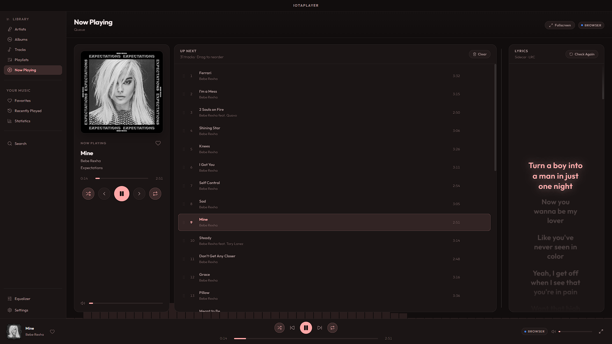 |
| *3-pane Now Playing view with synchronized lyrics, artwork, and resizable Up Next queue* |

| Fullscreen — Still Ambient Style | Fullscreen — Classic Style |
| :---: | :---: |
| 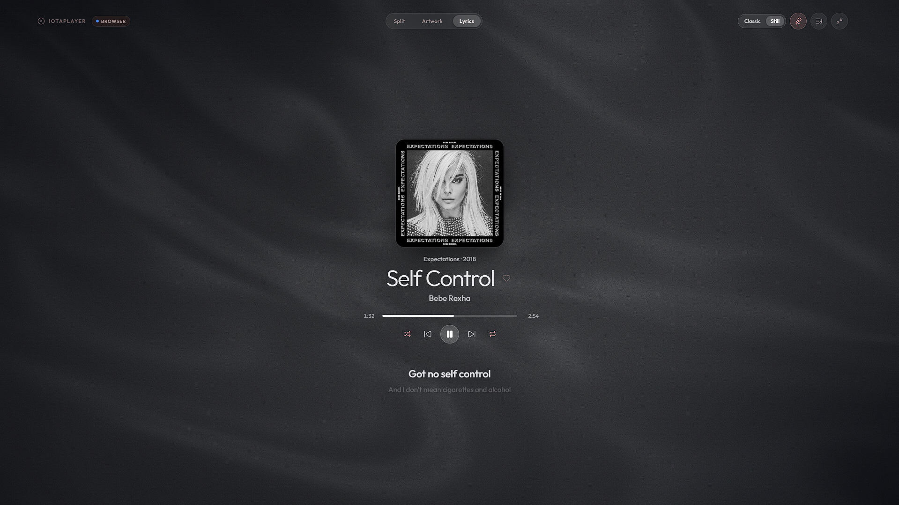 | 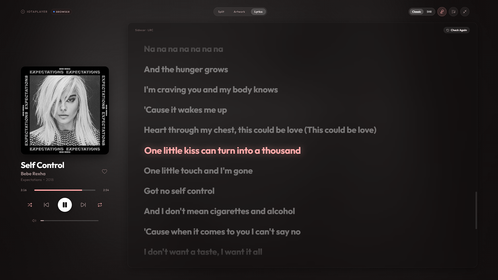 |
| *Editorial dark-glass Still ambient backdrop with subtle film grain* | *Classic blurred album-art backdrop with Split, Artwork, and Lyrics modes* |

---

### Library & Discovery

| Tracks | Albums |
| :---: | :---: |
| 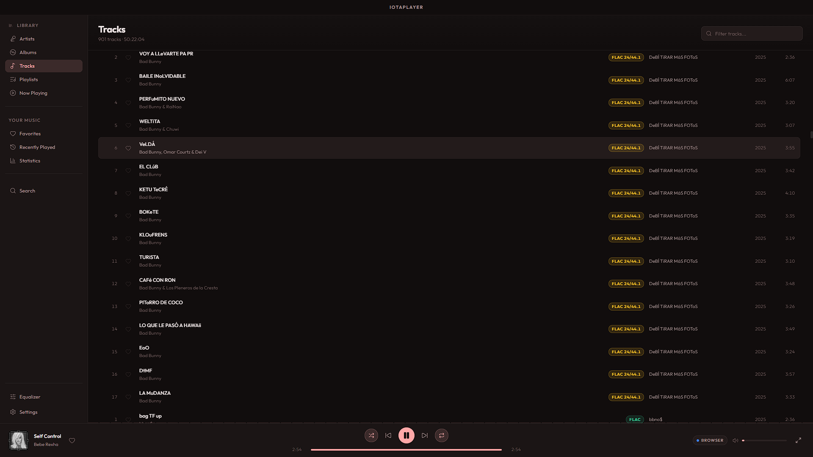 | 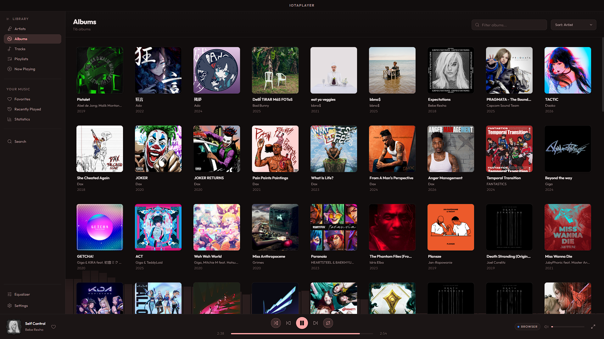 |
| *Track library with media quality badges and quick actions* | *Album grid view* |

| Artists | Search |
| :---: | :---: |
| 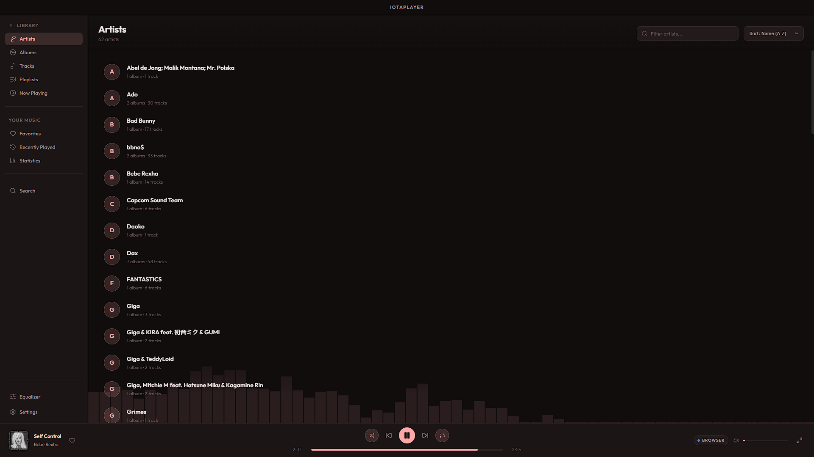 | 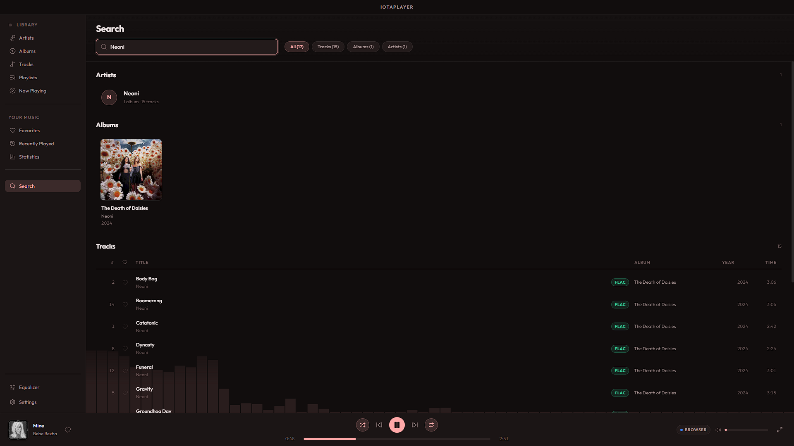 |
| *Artists directory* | *Multi-field library search across tracks, albums, and artists* |

| Library Statistics |
| :---: |
| 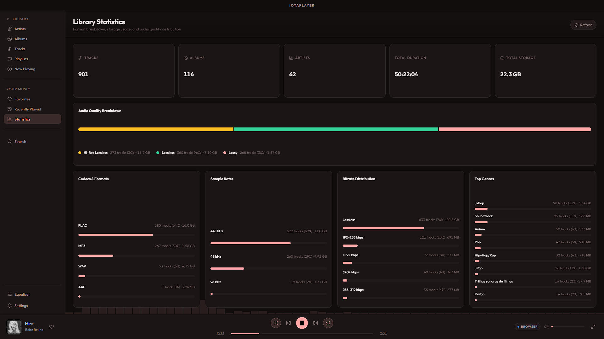 |
| *SQL-aggregated library breakdown by quality tiers, codecs, sample rates, and genres* |

---

### Playlists & History

| Playlists & Smart Playlists | Playlist Details |
| :---: | :---: |
| 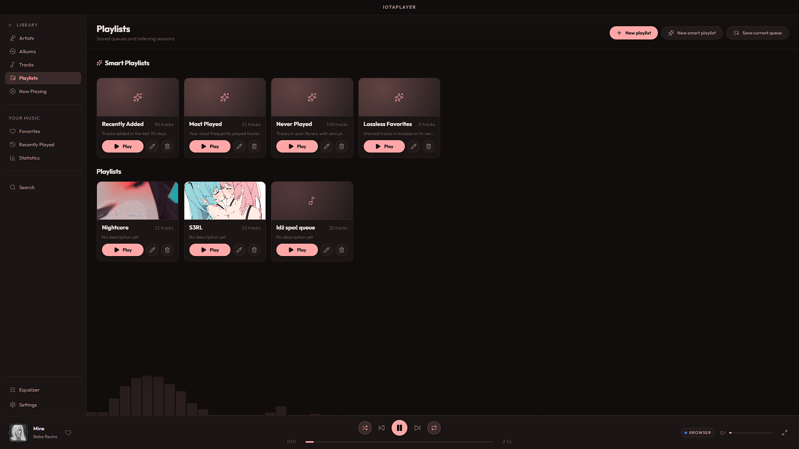 | 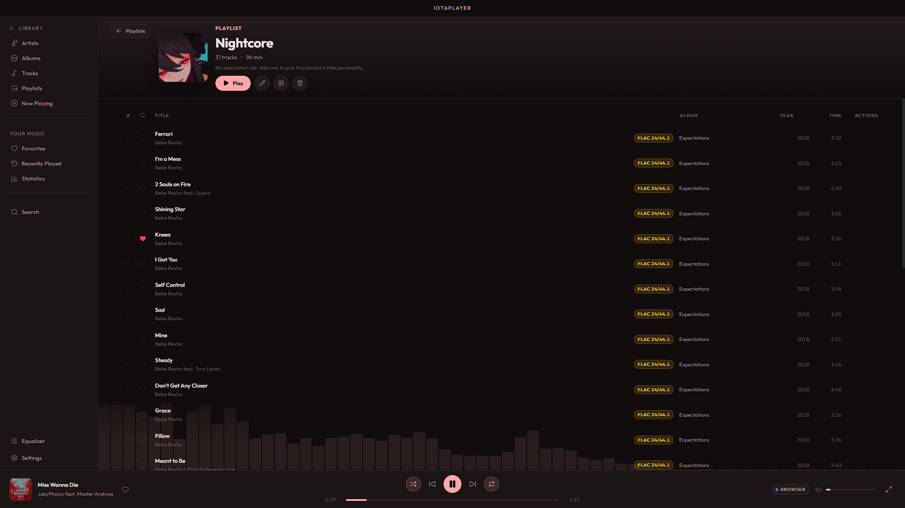 |
| *Standard and rule-based Smart Playlists* | *Custom cover art, drag-and-drop track reordering, and inline management* |

| Favorites | Recently Played |
| :---: | :---: |
| 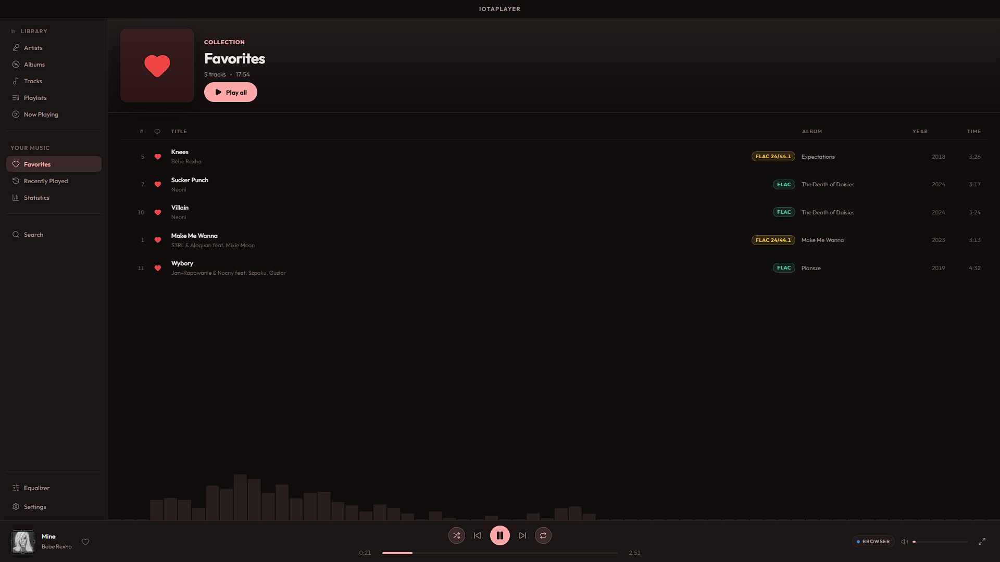 | 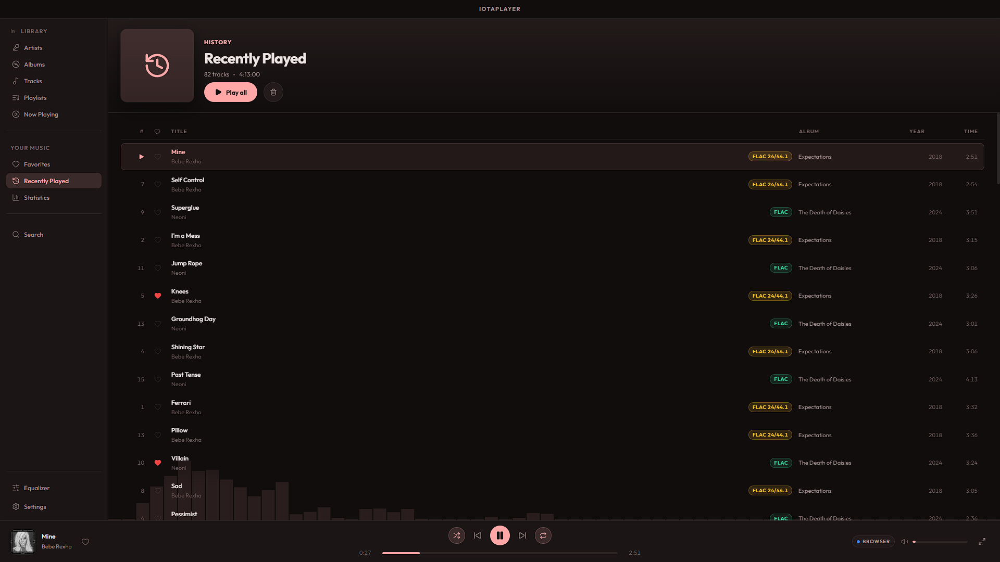 |
| *Favorited tracks collection* | *Playback history with one-click clearing* |

---

### Audio & Settings

| Equalizer & Playback Speed | Settings |
| :---: | :---: |
| 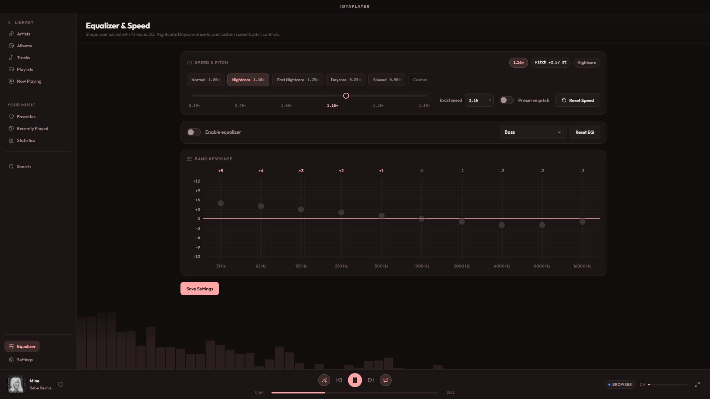 | 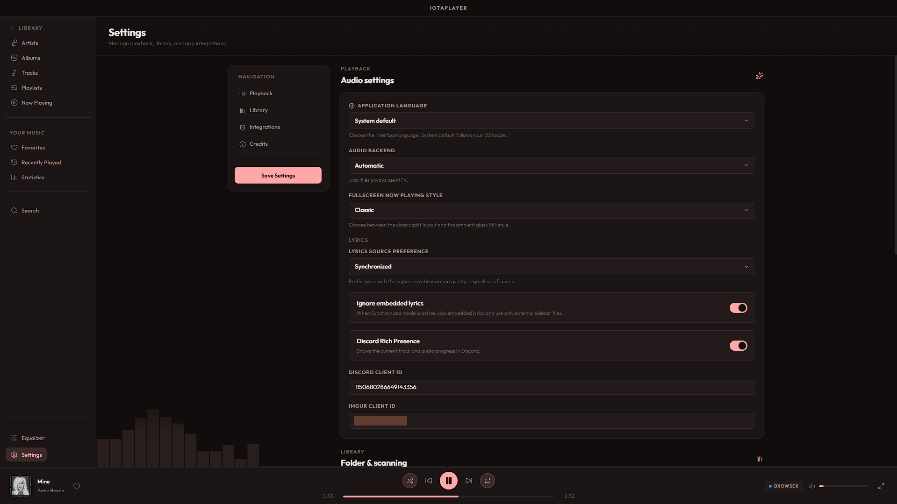 |
| *10-band parametric EQ, live visualizer, and speed/pitch presets (Nightcore, Daycore, Slowed)* | *Playback, Lyrics, Library, Appearance, Language, and Credits & Notices* |
